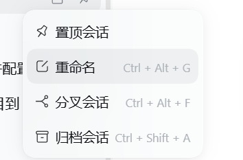

# dsh-plugin-delete-session

[English](README.en.md)

[](https://github.com/435434/dsh-plugin-delete-session/actions/workflows/ci.yml)
[](LICENSE)

给 DSH（DeepSeek Harness）每个会话的「…」菜单加一行 **删除会话** —— 位置在「置顶会话 / 重命名 / 分叉会话 / 归档会话」之后，是菜单的最后一行。



> 上图是**安装前**的菜单位置示意：安装本插件后，「归档会话」下面会再多出一行「删除会话」。

> DSH 自身没有提供删除会话的 API（Host 与 Client 都没有），所以本插件把整套操作自己做完了：删磁盘、清记账、刷前端。

已验证环境：DSH 0.2.0-rc.2 桌面版（Windows）。要求 DSH ≥ 0.2.0-rc.1。

## 特性

- 菜单里就地二次确认：红色提示 + `取消` / `确认删除`，危险按钮 700ms 后才解除禁用，避免双击误删。
- 正在使用中的会话会被拒绝删除，原因直接显示在菜单里，菜单不关闭，可重试。
- 删除成功后侧栏该行**立即消失**，不需要重启或手动刷新。
- 文案中英文跟随客户端语言；样式只使用 DSH 主题变量，明暗主题都正常。
- 只开放一个本机回环 POST 路由，没有别的入口。

## 安装

要求：DSH ≥ 0.2.0-rc.1。从 GitHub 安装需要本机能访问 GitHub；`github:` 形式由 pnpm 走 git 拉取，所以系统里需要有 `git` 命令。

### 方式一：从 GitHub 直接安装（推荐）

打开 DSH 侧栏的 **插件** 页面 → **添加插件**，把下面这一行粘进去回车：

```
github:435434/dsh-plugin-delete-session
```

也可以让 agent 用内置工具装：

```
plugin_manager { action: "install_bundle", target: "github:435434/dsh-plugin-delete-session" }
```

要锁定版本就带上 tag：

```
github:435434/dsh-plugin-delete-session#v0.1.0
```

安装完成后刷新页面，打开任意会话的「…」菜单，最后一行即 **删除会话**。

### 方式二：本地目录安装（开发 / 离线）

1. 把本目录（`git clone` 或直接下载解压）放到任意位置，例如 `D:\plugins\dsh-plugin-delete-session`。
2. 让 DSH 安装它 —— 用内置的 `plugin_manager`：

   ```
   plugin_manager { action: "install_bundle", target: "D:\\plugins\\dsh-plugin-delete-session" }
   ```

3. 刷新页面后，打开任意会话的「…」菜单，最后一行即 **删除会话**。

本包就是一个普通的 DSH `bundle + client` 包，用任何等价的安装方式（把它作为依赖装进 profile 并在 bundles 中启用）都可以。

### 方式三：从 npm 安装（可选）

把包发布到 npm（需要去掉 `package.json` 里的 `private`）后，用户可以按包名安装，此时**不需要**本机有 git：

```
plugin_manager { action: "install_bundle", target: "dsh-plugin-delete-session" }
```

### 卸载

```
plugin_manager { action: "remove_bundle", target: "dsh-plugin-delete-session" }
```

### 升级

覆盖本目录里的文件后重新安装；**修改已安装包的 JavaScript 需要重启应用**才会加载新的模块世代（重新安装本身不等于重载代码）。DSH 的插件不会自动更新：升级 = 卸载后装新版本。

## 配置

`cordis.patch.yml` 的 bundle 行支持一个配置项：

| 键 | 默认值 | 说明 |
| --- | --- | --- |
| `sessionsRoot` | `$DSH_HOME/sessions` | 会话存储根目录。一般不用改，只在自定义了 session-persistence-jsonl 的 `root` 时才需要。 |

```yaml
- insert:
    - id: delete-session
      name: 'dsh-plugin-delete-session'
      config:
        sessionsRoot: 'D:\\somewhere\\sessions'
```

## 工作原理

### 客户端（`client.js`）

一个 Module Loader bundle（纯 JavaScript，无 JSX、无 import，React 由加载器注入），向插槽 `sidebar.workspaces.session.menu.item` 注册一行：

- `id`: `dsh-plugin-delete-session.delete-session`，`order`: 500（排在归档 400 之后）
- 点击 → 原地展开确认 → 确认后 `POST /api/dsh-plugin-delete-session/delete`，body `{ sessionId, confirmed: true }`
- 成功后关闭菜单（宿主已经把行移除了）；失败则在菜单内显示原因并允许重试

### 宿主端（`index.js`）

1. 会话仍在宿主进程内存中处于打开状态 → 拒绝（日志文件被会话存储持有写句柄，硬删会破坏正在写入的状态）；
2. 删除磁盘上的会话目录：`<sessionsRoot>/<编码后的 cwd>/session-<uuid>/`（按目录名查找，不依赖 cwd 的编码规则）；
3. 从工作区记账里摘掉该 id（`Workspace.detachSession`），并清理置顶/归档集合；
4. 发出 `api-session/removed`，让浏览器端会话列表同步移除该行。

会话存储层（`sessionPersistence.list/stat`）和 SQLite 搜索索引都会重新扫描磁盘并容忍文件消失，索引在每次查询前会自我校准，因此不需要额外维护索引。

## 安全设计

- 路由 `/api/dsh-plugin-delete-session/delete` 只接受 `POST`，并且必须同时满足：对端是回环地址（`127.0.0.1` / `::1` / `::ffff:127.*`）、`Host` 与 `Origin` 指向本服务、body 带 `confirmed: true`。
- 会话 id 必须匹配 `^session-[A-Za-z0-9_-]+$`，杜绝路径穿越。
- 删除范围严格限定为 `<sessionsRoot>` 下、名字等于该会话 id 的目录。

## 限制

- **正在使用中的会话不能删除**：先切到别的会话（让宿主释放），或重启应用后再删。
- **彻底删除、没有回收站、不可恢复**。这是刻意的设计选择。
- 删除一个会话不会级联删除它的分叉/子会话。
- 没有浏览器控制的环境下无法自动验证真实点击链路，请手动点一次确认。

## 上架到插件市场

DSH 生态里的插件市场只从 curated 仓库 [awesome-dsh-plugin](https://github.com/awesome-dsh-plugin/awesome-dsh-plugin) 读取列表：想让插件出现在市场/市场站点里，去那个仓库提一个 PR 加一条记录即可（站点与市场会自动同步，通常一天内生效）。没上架也完全可以用上面的「方式一」直接安装。

## 目录结构

| 文件 | 作用 |
| --- | --- |
| `index.js` | 宿主端：HTTP 路由 + 删除/记账/事件 |
| `client.js` | 客户端：Module Loader bundle，注册会话菜单项 |
| `cordis.patch.yml` | bundle 层，把插件行挂进 profile |
| `icon.svg` | 插件图标（插件列表展示） |
| `docs/menu.png` | 菜单位置截图 |
| `test/host.test.mjs` | 宿主端逻辑单元测试（`node --test`） |
| `.github/workflows/ci.yml` | GitHub Actions：推送时跑测试 |
| `package.json` | 包清单（`dsh.bundle` + `dsh.client`） |
| `README.md` / `README.en.md` | 说明文档 |
| `CHANGELOG.md` / `LICENSE` | 变更记录 / MIT 许可 |

## 开发与测试

宿主端逻辑不依赖 DSH 运行时，可以直接测：

```bash
node --test
```

（如果所在沙箱禁止子进程开管道，`node --test` 会报 `spawn EPERM`；此时直接运行测试文件即可：`node test/host.test.mjs`。）

测试覆盖：会话 id 校验、同源守卫矩阵、会话目录查找、成功删除（含记账与事件）、活动会话拒绝、会话不存在时的报错。

## License

[MIT](LICENSE)
